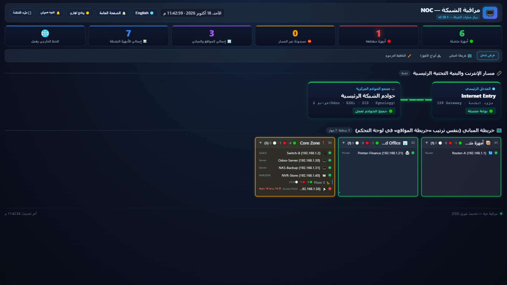
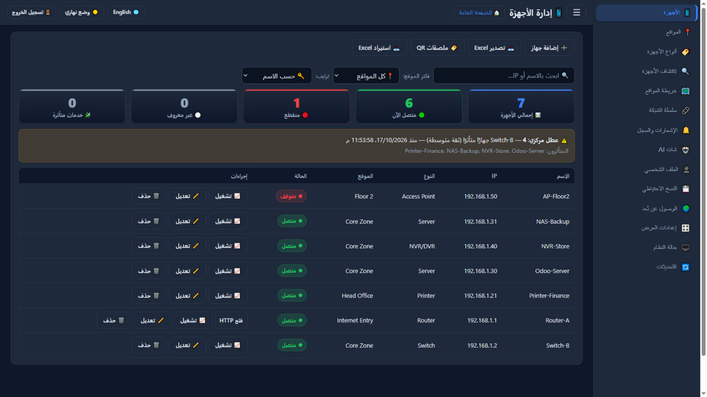
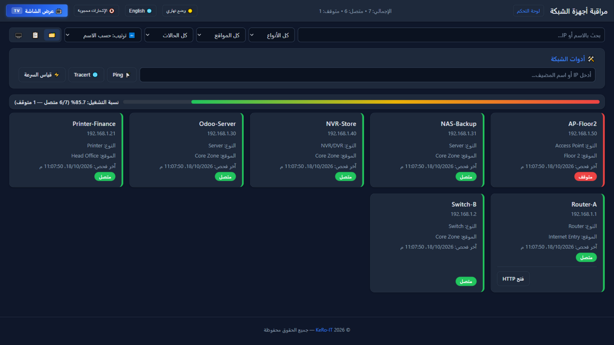

# 📡 نظام مراقبة أجهزة الشبكة — Network Monitor

[English](README.md) · **العربية**

[](https://github.com/kerolos-it2022/network-monitor/releases)
[](https://github.com/kerolos-it2022/network-monitor/actions/workflows/ci-cd.yml)
[-green.svg)](https://nodejs.org/)
[](https://web.dev/progressive-web-apps/)
[](docs/I18N.ar.md)
[](LICENSE)

نظام **تستضيفه بنفسك** لمراقبة أجهزة شبكتك المحلية — فايروول، سويتشات، راوترات، طابعات، NVR/DVR، نقاط
وصول، سيرفرات — مع **حالة لحظية**، و**شاشة NOC جدارية**، و**اكتشاف تلقائي** للأجهزة، وإشعارات فورية عبر
**تلجرام** و**واتساب** و**إشعارات الهاتف (PWA)**. كل شيء يعمل في عملية Node.js واحدة مع قاعدة بيانات
SQLite محلية: بلا حساب سحابي وبلا أي خدمة خارجية إلزامية.

> **الإصدار الحالي: v2.50.4** — واجهة بلغتين (عربي + إنجليزي بإعداد واحد)، ومراقبة **خدمات** لكل جهاز
> بحالة `DEGRADED`، ونِسَب تشغيل زمنية صادقة مع **تغطية** البيانات، و**عطل مركزي واحد** (RCA)، و**هوية
> ثابتة** لكل جهاز، وتحصين أمني متكامل، وصورة أبلاينس (Debian ISO) تُحدِّث نفسها بأمان.

## ✨ لقطات من النظام

<p align="center">
  
</p>
<p align="center"><b>شاشة NOC</b> — العرض اللحظي للشاشة الجدارية: سلسلة الإنترنت والعدّادات وحالة كل جهاز في نظرة واحدة</p>

<p align="center">
  
</p>
<p align="center"><b>لوحة التحكم</b> — كل جهاز بنوعه وموقعه وحالته اللحظية وأزرار التشغيل</p>

<p align="center">
  
</p>
<p align="center"><b>الصفحة العامة</b> — واجهة الزائر: بطاقات الأجهزة اللحظية وشريط نسبة التشغيل وأدوات الشبكة</p>

## ✅ أبرز المميزات

- 🔍 **اكتشاف بنمط Advanced IP Scanner** — مستمع دائم (NBNS / mDNS / LLMNR / SSDP) يجمع **الأسماء الحقيقية**
  من بثّ الشبكة نفسه، مع سلة اعتماد وقائمة ثقة ومسح فوري لنطاق الشبكة (منافذ، صانع MAC، DNS عكسي، نوع
  مقترح).
- 📡 **مراقبة لحظية كل 10 ثوانٍ** (ping / HTTP / HTTPS / منفذ TCP لكل جهاز) مع **شاشة NOC**: سلسلة
  الشبكة، الأسماء الحقيقية، أشرطة التشغيل، وغطاء إنذار أحمر يمكن كتمه.
- 🧩 **خدمات مراقَبة لكل جهاز** (أودو، واجهات ويب، منافذ TCP…): مضيف متصل وخدمة متوقفة = **DEGRADED**
  وتنبيه خاص بالخدمة بدل أن يختفي العطل داخل جهاز «أخضر».
- 🧠 **عطل مركزي واحد (RCA)** عند سقوط جهاز أعلى السلسلة: إشعار واحد يسمّي السبب والمتأثرين — مع بقاء
  سجل انقطاع مستقل لكل جهاز.
- 📈 **تشغيل صادق**: نسبة + **تغطية** + جودة بيانات لكل جهاز (24 ساعة / 7 أيام / 30 يومًا)، وتجميعات
  محفوظة 90 يومًا بعد تنظيف السجلات الخام.
- 🪪 **هوية ثابتة للجهاز** (`NM-000123`): عدة MACs وسجل عناوين IP — تغيّر DHCP لا يُفقد الهوية، وأي
  التباس يدخل **قائمة مراجعة** بلا دمج تلقائي.
- 🔔 **إشعارات ذكية**: تلجرام + واتساب + إشعارات الهاتف · تجميع العواصف · تقرير يومي (مع تحليل AI اختياري)
  · تصعيد انقطاع مع تذكير دوري اختياري · بوت تلجرام تفاعلي بأزرار.
- 🤖 **شات AI عن شبكتك** — يجيب من قاعدة بياناتك المحلية عبر مفتاح أي مزوّد متوافق مع OpenAI (اختياري).
  العناوين الداخلية و MAC تُنقَّح قبل أي إرسال، ووضع «بقواعد محلية» يعمل بلا إنترنت إطلاقًا.
- 🏷️ **ملصقات QR** لكل جهاز — مسحة واحدة بالموبايل تعرض بطاقة الجهاز كاملة.
- 💾 نسخ احتياطي مجدول · 🧹 أرشفة سجل الانقطاع وتقليصه · 📄 تقارير أسبوعية للطباعة · 📊 تصدير Excel/CSV.
- 🔐 حسابات متعددة (مدير / عرض) · قفل محاولات الدخول · سجل تدقيق · حماية CSRF · شاشة حالة النظام.
- 🌐 **لغتان: إنجليزي (افتراضي) وعربي** — إعداد واحد في اللوحة يبدّل اللوحة والصفحة العامة وشاشة NOC
  معًا، والاتجاه ينقلب (LTR ↔ RTL) وتبقى العناوين والتواريخ مقروءة صحيحة. والصفحة العامة وشاشة NOC
  عليهما زرّ لغة كذلك، فيقرأ الزائر أيّهما شاء بلا مساس بإعداد النظام. وللإشعارات زرّ ثانٍ خاص بلغة
  الرسائل المُرسَلة.

## 🧱 التقنيات

| الطبقة | الاختيار |
|---|---|
| التشغيل | Node.js ≥ 22 (يُوصى بـ 24 LTS) |
| الخادم | Express — REST + SSE وصفحات ثابتة RTL/LTR |
| قاعدة البيانات | SQLite عبر better-sqlite3 (وضع WAL، اتصال متزامن واحد) |
| الواجهة | جافاسكربت خام بلا خطوة بناء + PWA و service worker |
| الإشعارات | Telegram Bot API · مزوّد WhatsApp API · Web Push (VAPID تُولَّد ذاتيًّا) |
| النشر | PM2 أو systemd · Nginx (اختياري) · صورة أبلاينس Debian 12 |

## 🎯 المتطلبات

| المتطلب | الإصدار | ملاحظات |
|---|---|---|
| **Node.js** | **22 أو أعلى (يُوصى بـ 24 LTS)** | `better-sqlite3@13` يشترط ≥ 22 |
| **sqlite3 CLI** | أي إصدار | لإنشاء ملف القاعدة من `database/schema.sql` فقط |
| **pm2** | الأحدث | `npm install -g pm2` (لنشر Linux) |
| **Git** | أي إصدار | للاستنساخ والتحديث |
| **متصفح** | Chrome 90+ / Edge 90+ / Firefox 90+ / Safari 16.4+ | لـ PWA و Web Push |

## ⚡ التشغيل السريع

```bash
git clone https://github.com/kerolos-it2022/network-monitor.git
cd network-monitor

# ١) قاعدة البيانات
mkdir -p database && sqlite3 database/monitoring.db < database/schema.sql

# ٢) الإعدادات
cp backend/.env.example backend/.env        # ثم عدّل backend/.env

# ٣) التثبيت + أول مدير + التشغيل
cd backend && npm install
node src/seedAdmin.js
npm start
```

| الواجهة | الرابط |
|---|---|
| 🌐 الصفحة العامة (حالة الأجهزة) | `http://localhost:4000/` |
| 🖥️ شاشة NOC (للعرض على TV) | `http://localhost:4000/noc.html` |
| 🔐 تسجيل الدخول | `http://localhost:4000/admin/login.html` |
| 📊 لوحة التحكم | `http://localhost:4000/admin/dashboard.html` |

> 🔑 أول حساب مدير يأتي من `DEFAULT_ADMIN_USERNAME` و`DEFAULT_ADMIN_PASSWORD` في `backend/.env`
> (ويُرفض أي افتراضي ضعيف إلا بـ`NM_ALLOW_WEAK_ADMIN=1`). **غيّر كلمة المرور فورًا بعد أول دخول.**
> 📝 على Windows بلا أمر `sqlite3`، استورد `database/schema.sql` بـ
> [DB Browser for SQLite](https://sqlitebrowser.org/).

## 🐧 النشر على سيرفر Linux (الطريقة المعتمدة)

سكربت `deploy.sh` يكتشف التوزيعة (Debian/Ubuntu · عائلة RHEL · Arch · Alpine · openSUSE) ويتولّى كل شيء:

```bash
sudo mkdir -p /opt && sudo chown "$USER":"$USER" /opt
cd /opt && git clone https://github.com/kerolos-it2022/network-monitor.git network-monitor
cd network-monitor && sudo bash deploy.sh install
```

يثبّت أدوات البناء و**Node.js 24 LTS** و PM2، ويُنشئ `backend/.env` بسرّ جلسة عشوائي ومفاتيح VAPID
جديدة، ويعيد بناء `better-sqlite3` للنظام المستهدف، ويجهّز القاعدة وينشئ المدير، ثم يشغّل التطبيق تحت PM2
ويطبع روابط الوصول.

```bash
pm2 status                  # حالة الخدمة
pm2 logs network-monitor    # السجلات اللحظية
pm2 restart network-monitor # إعادة تشغيل بعد تعديل إعداد
```

دليل النشر الإنتاجي الكامل (Nginx · HTTPS · الجدار الناري · النسخ الاحتياطي):
[docs/DEPLOY.ar.md](docs/DEPLOY.ar.md) · وبديل systemd/Nginx عن PM2: [docs/linux-setup/](docs/linux-setup/).

## 🔄 التحديثات من GitHub

تبويب **التحديثات** في اللوحة يفحص وسوم GitHub عبر الـAPI ويعرض: شريط حالة، وتقدّمًا بخطوات، ونافذة سجل
التغييرات، وشارة «تحديث متاح» (فحص عند الفتح وكل ٦ ساعات)، و**الرجوع لإصدار أقدم** من قائمة الوسوم، وزرّ
**نسخة احتياطية ثم تحديث**.

**التحديث لا يحدث تلقائيًّا أبدًا** — لا شيء يُنزَّل أو يُثبَّت إلا بضغطك على الزر، وعلى صورة الأبلاينس
يتولّى العمل مساعد root منفصل (خدمة الويب لا تستطيع الكتابة في كودها — انظر
[appliance/README.ar.md](appliance/README.ar.md)). ويدويًّا على السيرفر:

```bash
cd /opt/network-monitor && ./update.sh
```

## 🔍 اكتشاف الشبكة

- **مسح النطاق بالـping** + فحص **24 منفذًا شائعًا** لكل جهاز (SSH · HTTP(S) · RDP · SMB · RTSP…).
- **تحديد الصانع من MAC** (أكثر من 50 بائعًا) و**DNS عكسي** و**استخراج الاسم عبر SMB/NetBIOS** ومستمع
  دائم (NBNS/mDNS/LLMNR/SSDP) يلتقط الاسم الذي يعلن الجهاز عن نفسه.
- **نوع مقترح للجهاز** (كاميرا · طابعة · راوتر · سيرفر · NAS…) مع زمن الاستجابة والمنافذ المفتوحة.
- النتائج تدخل **سلة اعتماد**: تختار ما تريد إضافته للمراقبة، وقائمة الثقة تُسكِت الباقي.

## 🔔 الإشعارات

| القناة | الإعداد |
|---|---|
| **تلجرام** | أنشئ بوتًا عبر [@BotFather](https://t.me/BotFather) وانسخ التوكن، واعرف `chat.id` من `https://api.telegram.org/bot<TOKEN>/getUpdates`، ثم فعّل القناة في تبويب **الإشعارات** واضغط *اختبار*. والبوت التفاعلي يضيف `/status` و`/down` وأزرار استعلام تحت رسائل الانقطاع. |
| **واتساب** | أي مزوّد API: رابط + توكن + رقم المستلم، ويُفعَّل من تبويب **الإشعارات**. |
| **إشعارات الهاتف (PWA)** | بلا أي إعداد: الخادم **يولّد مفاتيح VAPID عند أول إقلاع** ويحفظها في ملف إعداداته (ثبات المفاتيح شرط بقاء تسجيلات الهواتف صالحة). افتح الصفحة العامة على الهاتف، اضغط **🔔 تفعيل الإشعارات**، ثم *إضافة إلى الشاشة الرئيسية*. |

أزرار الاختبار لكل قناة تُخبرك بالسبب الدقيق لتخطّي أي قناة (معطّلة · توكن ناقص · لا يوجد هاتف مسجَّل…)
بدل «فشل» مبهم، وكل محاولة تُكتب في **سجل الإشعارات** — شاشة فيها فلاتر وترتيب و**زرّ لغة للرسائل**
(انظر [docs/I18N.ar.md](docs/I18N.ar.md)).

## ⚙️ الإعدادات

كل الأسماء والشروح في [`backend/.env.example`](backend/.env.example). وأهمّها:

| المتغيّر | الوظيفة |
|---|---|
| `PORT` | منفذ الخادم (افتراضي 4000) |
| `DB_PATH` | مسار ملف SQLite (نسبي أو مطلق) |
| `SESSION_SECRET` | سرّ الجلسة — يولّده `deploy.sh` أو يولّده الخادم عشوائيًّا عند الإقلاع |
| `DEFAULT_ADMIN_USERNAME` / `DEFAULT_ADMIN_PASSWORD` | أول تشغيل فقط |
| `SESSION_MAX_AGE` | عمر الجلسة بالمللي ثانية (افتراضي 12 ساعة) |
| `TELEGRAM_BOT_TOKEN` / `TELEGRAM_CHAT_ID` | إشعارات تلجرام |
| `WHATSAPP_API_URL` / `WHATSAPP_API_TOKEN` / `WHATSAPP_TO_NUMBER` | إشعارات واتساب |
| `VAPID_PUBLIC_KEY` / `VAPID_PRIVATE_KEY` / `VAPID_SUBJECT` | مفاتيح Web Push — **تُولَّد وتُحفظ تلقائيًّا** عند غيابها |
| `MOBILE_ENABLED` | مفتاح تشغيل إشعارات الهاتف (1/0) |
| `GITHUB_REPO_URL` / `GITHUB_BRANCH` / `GITHUB_TOKEN` | مصدر التحديثات (التوكن اختياري — يرفع حدّ الـAPI) |
| `NM_MAX_CONCURRENT_CHECKS` · `NM_TOOLS_*` · `NM_WATCHDOG_*` | حدود التحميل · سياسة أدوات التشخيص · حراسة محرك المراقبة |

> 🔐 القيم السرّية مكانها `backend/.env` فقط (غير متعقَّب في git) — والمستودع يحتوي قالبًا بقيم توضيحية.

## 📁 هيكل المشروع

```
network-monitor/
├── backend/
│   ├── src/
│   │   ├── server.js          # نقطة البداية (Express + ثوابت + مسارات)
│   │   ├── app.js             # تجميع التطبيق + /api/health (يقرأ الإصدار من package.json)
│   │   ├── db.js              # اتصال better-sqlite3 + الهجرات الآمنة
│   │   ├── seedAdmin.js       # مدير أول تشغيل
│   │   ├── routes/            # auth · devices · locations · device-types · map · topology · live (SSE)
│   │   │                      # notifications · tools · update · appliance-update · backup · ai · system
│   │   ├── services/          # محرك المراقبة · الفاحصون · الإشعارات · الأعطال وRCA · الاكتشاف
│   │   │                      # السجل والتشغيل · النسخ الاحتياطي · ngrok · كلمة مرور الكونسول
│   │   └── middleware/        # الجلسات والأدوار · CSRF · التدقيق
│   ├── test/                  # اختبارات node:test (169 اختبارًا) — `npm test`
│   ├── package.json
│   └── .env.example
├── frontend/public/
│   ├── index.html             # الصفحة العامة
│   ├── noc.html               # شاشة NOC
│   ├── admin/                 # login.html + dashboard.html
│   ├── css/                   # style.css (الصفحات) + ui.css (طبقة التصميم المشتركة) + noc.css
│   ├── js/                    # public-* · admin-* · noc.js · nm-i18n(+en) · nm-format · nm-lang
│   ├── sw.js                  # service worker (PWA + الإشعارات)
│   └── manifest.json
├── database/schema.sql        # المخطط الكامل + هجرات آمنة عند الإقلاع
├── appliance/                 # بناء ISO (live-build) + hooks + مساعدات root + تنصيب على القرص
├── docs/                      # أدلة بلغتين + لقطات + linux-setup + archive
├── deploy.sh · update.sh · ecosystem.config.js · nginx*.conf
└── .github/                   # CI · بناء ISO · ملاحظات الإصدار · سياسة الأمان · القوالب
```

## 🔌 مرجع API (مختصر)

العنوان الأساسي `http://<host>:4000/api` — و`🔒` تعني «يحتاج جلسة» (والكتابة للمدير إلا ما ذُكر).

| المسار | الطريقة | الوصف |
|---|---|---|
| `/health` | GET | صحة الخادم **والإصدار الحالي** |
| `/live/status` | GET | بثّ حيّ SSE لحالات الأجهزة والعدّادات (لقطة ثم التغييرات) |
| `/auth/login` · `/auth/logout` · `/auth/me` | POST/POST/GET | إدارة الجلسة |
| `/devices` · `/devices/:id` | GET/POST/PUT/DELETE | الأجهزة |
| `/devices/:id/history?range=24h\|7d\|30d` | GET | سجل الحالة ونسبة التشغيل مع التغطية |
| `/devices/export/excel` · `/devices/import/excel` | GET/POST | 🔒 تصدير/استيراد Excel |
| `/locations` · `/device-types` | GET/POST/PUT/DELETE | المواقع والأنواع (الكتابة 🔒) |
| `/map/tree` · `/topology` · `/topology/layout` | GET/POST | شجرة المواقع · سلسلة الشبكة · حفظ المواضع |
| `/notifications/settings` · `/notifications/test` · `/notifications/logs` | GET/PUT/POST/GET | 🔒 الإشعارات |
| `/notifications/register` · `/notifications/vapid-public` | POST/DELETE · GET | تسجيل الهاتف + المفتاح العام |
| `/tools/ping` · `/tools/tracert` | GET | أدوات تشخيص حيّة عبر SSE |
| `/backup/info` · `/backup/list` · `/backup/restore` | GET/POST | 🔒 النسخ الاحتياطي |
| `/update/check` · `/update/perform` · `/update/history` | POST/GET | 🔒 تحديثات GitHub |
| `/appliance-update/mode` · `/progress` · `/request` | GET/POST | 🔒 مساعد تحديث الأبلاينس |
| `/public/status` · `/public/topology` | GET | بيانات مُنقّاة للصفحة العامة |

## ✅ الاختبار

```bash
cd backend && npm test        # node:test — 169 اختبارًا (API · أمان · تكافؤ الترجمة · الإشعارات · السجل)
curl http://localhost:4000/api/health
```

كل رفع أو Pull Request يشغّل نفس الفحوص في CI (`.github/workflows/ci-cd.yml`): فحص صياغة جافاسكربت للواجهة
والخادم، واختبار صحة الخادم، ومجموعة الاختبارات كاملة على Node 24. والـCI **لا ينشر شيئًا تلقائيًّا** —
النشر خطوة يدوية مقصودة.

## 🛡️ الأمان

| الطبقة | التنفيذ |
|---|---|
| كلمات المرور | bcrypt (10 دورات) + قفل بعد محاولات فاشلة متكررة |
| SQL | Prepared Statements فقط |
| الجلسات | `express-session` بسرّ عشوائي طويل + كوكيز httpOnly + مخزن دائم |
| الويب | ترويسات Helmet + كوكيز SameSite + حارس CSRF على المسارات المتغيّرة |
| الصلاحيات | أدوار مدير/عرض · والصفحة العامة وNOC تعرضان بيانات **مُنقّاة** بلا جرد داخلي |
| الأسرار | مقنّعة في الواجهة (آخر 4 خانات) ومحفوظة في `backend/.env` فقط |
| الأبلاينس | تحصين systemd + مساعد root منفصل للتحديث والوصول عن بُعد (وسم/أمر من قائمة بيضاء فقط) |
| التدقيق | تسجيل الدخول وتغيير الإعدادات والتحديثات والاستعادة والعمليات الخطِرة |

للإبلاغ عن ثغرة: [docs/SECURITY.ar.md](docs/SECURITY.ar.md) (وبالإنجليزية: [SECURITY.md](.github/SECURITY.md)).

## 📚 ملفات التوثيق

| الملف | اللغة |
|---|---|
| [docs/DEPLOY.ar.md](docs/DEPLOY.ar.md) | العربية — النشر الإنتاجي (Nginx · HTTPS · الجدار الناري · النسخ الاحتياطي · الترقية) |
| [docs/DEPLOY.md](docs/DEPLOY.md) | English |
| [docs/ARCHITECTURE.ar.md](docs/ARCHITECTURE.ar.md) | العربية — كيف تتركّب الأجزاء |
| [docs/ARCHITECTURE.md](docs/ARCHITECTURE.md) | English |
| [docs/I18N.ar.md](docs/I18N.ar.md) · [docs/I18N.md](docs/I18N.md) | العربية · English — نموذج اللغتين |
| [appliance/README.ar.md](appliance/README.ar.md) · [appliance/README.md](appliance/README.md) | العربية · English — بناء الصورة وتنصيبها |
| [CHANGELOG.md](CHANGELOG.md) | سجل التغييرات الكامل |

## 🤝 المساهمة

مشروع **مملوك** ومنشور للاطّلاع والمراجعة — راجع الترخيص أدناه قبل إعادة استخدام أي جزء منه. تقارير
الأخطاء وطلبات الميزات مرحّب بها عبر قوالب الـIssues، ويُرجى تشغيل `cd backend && npm test` و`node --check`
على أي ملف عدّلته قبل فتح Pull Request (نفس ما يفعله الـCI).

## 📄 الترخيص

**مملوك — جميع الحقوق محفوظة.** الكود منشور في مستودع عام للاطّلاع والمراجعة فقط، ولا يُمنح أي حق في
استخدامه أو نسخه أو تعديله أو توزيعه أو بيعه — كليًّا أو جزئيًّا — دون إذن كتابي مسبق من صاحب الحقوق.
راجع ملف [LICENSE](LICENSE).

## 🙏 مبني بـ

[Express](https://expressjs.com/) · [better-sqlite3](https://github.com/WiseLibs/better-sqlite3) ·
[web-push](https://github.com/web-push-libs/web-push) · [Chart.js](https://www.chartjs.org/) ·
[PM2](https://pm2.keymetrics.io/)

