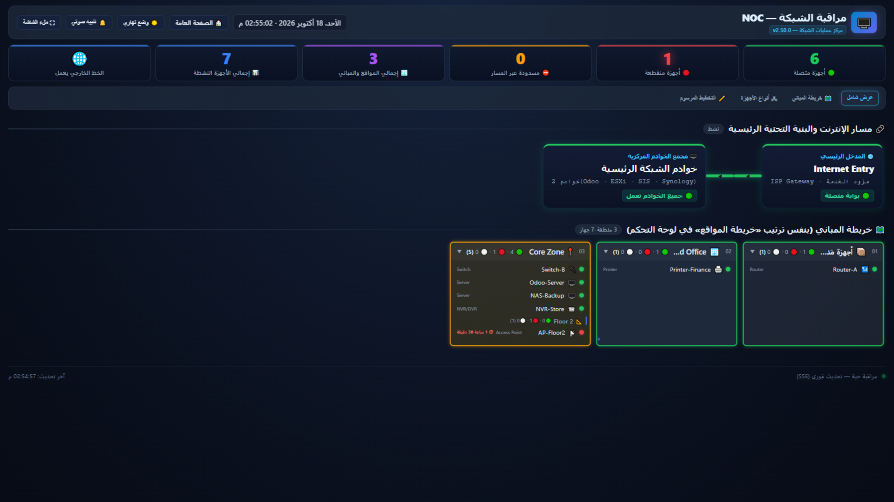
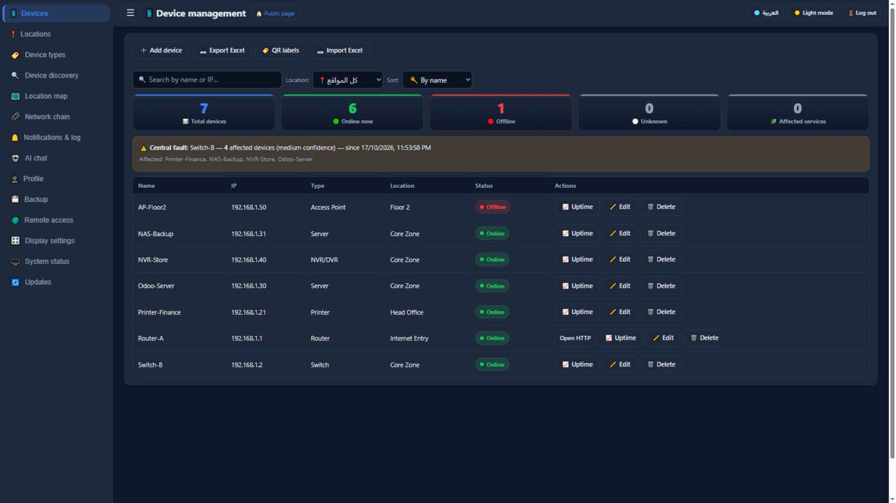
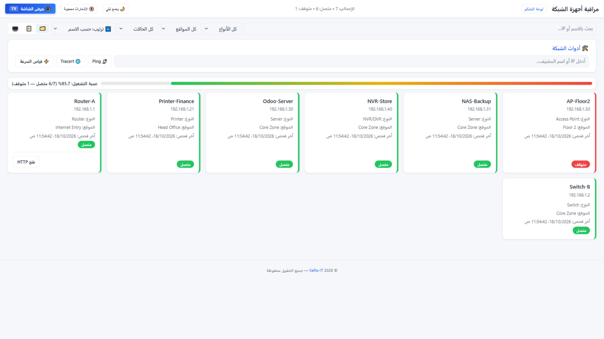

# 📡 Network Monitor — local network device monitoring

**English** · [العربية](README.ar.md)

[](https://github.com/kerolos-it2022/network-monitor/releases)
[](https://github.com/kerolos-it2022/network-monitor/actions/workflows/ci-cd.yml)
[-green.svg)](https://nodejs.org/)
[](https://web.dev/progressive-web-apps/)
[](docs/I18N.md)
[](LICENSE)

A self-hosted monitor for the devices on your own LAN — firewalls, switches, routers, printers, NVR/DVR,
access points, servers — with **live status**, an **NOC wall screen**, automatic **discovery**, and instant
alerts through **Telegram**, **WhatsApp** and **mobile push (PWA)**. Everything runs on one small Node.js
process with a local SQLite database: no cloud account, no external service required.

> **Current release: v2.50.0** — bilingual UI (Arabic + English with one setting), per-service monitoring
> with `DEGRADED`, time-weighted uptime with data coverage, single root-cause incident (RCA), stable device
> identities, hardened multi-account security, and a Debian appliance ISO that updates itself safely.

## ✨ Screenshots

<p align="center">
  
</p>
<p align="center"><b>NOC wall screen</b> — the live view for a TV: internet chain, counters, per-device state</p>

<p align="center">
  
  
</p>
<p align="center"><b>Admin dashboard</b> and the <b>public status page</b> — dark and light themes</p>

## ✅ Highlights

- 🔍 **Discovery in the style of Advanced IP Scanner** — a resident listener (NBNS / mDNS / LLMNR / SSDP)
  collects the **real device names** from the network's own broadcasts, plus a pending basket, a trust list
  and on-demand subnet sweeps (ports, MAC vendor, reverse DNS, suggested device type).
- 📡 **Live monitoring every 10 seconds** (ping / HTTP / HTTPS / TCP port, per device) with a **NOC wall
  screen**: network chain, real names, uptime bars and a red alert overlay you can silence.
- 🧩 **Monitored services per device** (Odoo, web UIs, TCP ports…): a reachable host with a dead service
  becomes **DEGRADED** and raises its own alert instead of hiding inside a green device.
- 🧠 **One root-cause incident (RCA)** when a parent device drops: a single alert naming the upstream
  culprit and the affected devices — while each device keeps its own downtime history.
- 📈 **Honest uptime**: percentage **with coverage and data-quality** per device (24 h / 7 d / 30 d) and
  90-day rollups kept after the raw logs are pruned.
- 🪪 **Stable asset identity** (`NM-000123`): several MACs and an IP history per device — a DHCP change
  never loses the identity, and a clash goes to a **review list** instead of merging silently.
- 🔔 **Smart alerts**: Telegram + WhatsApp + Web Push · storm batching · daily report (optional AI summary)
  · outage escalation with an optional repeating reminder · an interactive Telegram bot with inline buttons.
- 🤖 **AI chat about your own network** — answers from your local database, through any OpenAI-compatible
  key (optional). Internal IPs/MACs are redacted before anything leaves the box, and a local rules mode
  answers with no internet at all.
- 🏷️ **QR labels** per device — one scan from a phone shows the full device card.
- 💾 Scheduled backups · 🧹 downtime archive & retention · 📄 printable weekly reports · 📊 Excel/CSV export.
- 🔐 Multi-account (admin / viewer) · login lockout · audit log · CSRF protection · a System-status screen.
- 🌐 **Two languages: Arabic (default) and English** — one setting in the dashboard switches the dashboard,
  the public page and the NOC screen together, and the layout flips RTL ↔ LTR while IPs and dates stay
  readable. Notifications keep their own language switch on the log screen.

## 🧱 Tech stack

| Layer | Choice |
|---|---|
| Runtime | Node.js ≥ 22 (24 LTS recommended) |
| Server | Express — REST + SSE, static RTL/LTR pages |
| Database | SQLite via better-sqlite3 (WAL, one synchronous connection) |
| Frontend | Vanilla JS, no build step, installable PWA + service worker |
| Notifications | Telegram Bot API · WhatsApp provider API · Web Push (VAPID, self-generated) |
| Deployment | PM2 or systemd · Nginx reverse proxy (optional) · Debian 12 appliance ISO |

## 🎯 Requirements

| Requirement | Version | Notes |
|---|---|---|
| **Node.js** | **22 or newer (24 LTS recommended)** | `better-sqlite3@13` requires ≥ 22 |
| **sqlite3 CLI** | any | Only to create the database file from `database/schema.sql` |
| **pm2** | latest | `npm install -g pm2` (Linux production) |
| **Git** | any | To clone and to update |
| **Browser** | Chrome 90+ / Edge 90+ / Firefox 90+ / Safari 16.4+ | PWA + Web Push |

## ⚡ Quick start

```bash
git clone https://github.com/kerolos-it2022/network-monitor.git
cd network-monitor

# 1) database
mkdir -p database && sqlite3 database/monitoring.db < database/schema.sql

# 2) settings
cp backend/.env.example backend/.env        # then edit backend/.env

# 3) install + first admin + run
cd backend && npm install
node src/seedAdmin.js
npm start
```

| Page | URL |
|---|---|
| 🌐 Public status page | `http://localhost:4000/` |
| 🖥️ NOC wall screen | `http://localhost:4000/noc.html` |
| 🔐 Admin login | `http://localhost:4000/admin/login.html` |
| 📊 Dashboard | `http://localhost:4000/admin/dashboard.html` |

> 🔑 The first admin comes from `DEFAULT_ADMIN_USERNAME` / `DEFAULT_ADMIN_PASSWORD` in `backend/.env`
> (weak defaults are refused unless `NM_ALLOW_WEAK_ADMIN=1`). **Change the password right after the first
> login.**
> 📝 On Windows without the `sqlite3` CLI, import `database/schema.sql` with
> [DB Browser for SQLite](https://sqlitebrowser.org/).

## 🐧 Deploying on a Linux server (recommended path)

`deploy.sh` detects the distribution (Debian/Ubuntu, RHEL family, Arch, Alpine, openSUSE) and does the whole
install:

```bash
sudo mkdir -p /opt && sudo chown "$USER":"$USER" /opt
cd /opt && git clone https://github.com/kerolos-it2022/network-monitor.git network-monitor
cd network-monitor && sudo bash deploy.sh install
```

It installs the build tools, **Node.js 24 LTS** and PM2, creates `backend/.env` with a random session secret
and freshly generated VAPID keys, rebuilds `better-sqlite3` for the target system, prepares the database,
seeds the admin, starts the app under PM2 and prints the access URLs.

```bash
pm2 status                  # service state
pm2 logs network-monitor    # live logs
pm2 restart network-monitor # restart after a config change
```

Full production guide (Nginx, HTTPS, firewall, backups, multi-site notes):
[docs/DEPLOY.md](docs/DEPLOY.md) · systemd/Nginx alternative to PM2: [docs/linux-setup/](docs/linux-setup/).

## 💿 Appliance ISO (bootable Debian)

- Built by [`.github/workflows/build-iso.yml`](.github/workflows/build-iso.yml) automatically on any `v*`
  tag (attached to the GitHub Release together with `SHA256SUMS.txt`), or manually:
  `cd appliance && NM_VERSION=v2.50.0 bash build.sh` (inside a `debian:bookworm` container).
- The installer writes the system to disk and sets **one password for every door** — the web admin account,
  the console menu on `tty1` and the Linux account `sysadmin` — through a single root helper.
- On the installed system the web service runs as `netmon` with systemd hardening
  (`ProtectSystem=strict`, `NoNewPrivileges`, `PrivateTmp`) and can only write inside
  `/var/lib/network-monitor`. Updates go through a **separate root helper**: the dashboard writes a request
  file containing **nothing but a tag**, `nm-update.path` triggers `nm-update.service` (root), which
  downloads from the repository, `rsync`s the files, runs `npm ci` and restarts the service — the web
  process can never write to its own code.

Details: [appliance/README.md](appliance/README.md).

## 🔄 Updates from GitHub

The **Updates** tab in the dashboard checks GitHub tags through the API and shows a status bar, step-by-step
progress, a changelog modal, an update-available badge (checked when the tab opens and every 6 hours),
**restore-a-previous-version** from the tag list, and a **backup-then-update** button.

**Updates are never automatic** — nothing is downloaded or installed until you press the button, and on the
appliance the actual work is done by the root helper described above. Manual path on a server:

```bash
cd /opt/network-monitor && ./update.sh
```

## 🔍 Network discovery

- **Ping sweep** of the subnet, plus **24 common ports** per host (SSH, HTTP(S), RDP, SMB, RTSP…).
- **MAC vendor lookup** (50+ vendors), **reverse DNS**, **SMB/NetBIOS name resolution** and a resident
  NBNS/mDNS/LLMNR/SSDP listener that captures the name the device announces about itself.
- Suggested **device type** (camera, printer, router, server, NAS…), response time and open ports.
- Scan results land in a pending basket: pick the devices you want and add them to monitoring; a trust list
  keeps the rest quiet.

## 🔔 Notifications

| Channel | Setup |
|---|---|
| **Telegram** | Create a bot with [@BotFather](https://t.me/BotFather), copy the token, get the chat id (`https://api.telegram.org/bot<TOKEN>/getUpdates` → `chat.id`), then enable the channel in **Notifications** and press *Test*. An interactive bot adds `/status`, `/down` and inline query buttons under outage messages. |
| **WhatsApp** | Any provider API: URL + token + recipient number, enabled in **Notifications**. |
| **Mobile push (PWA)** | No setup: the server generates its **VAPID keys on first boot** and keeps them in its settings file (stable keys keep phone subscriptions valid). Open the public page on the phone, press **🔔 Enable notifications**, then *Add to Home Screen*. |

Per-channel test buttons tell you exactly why a channel was skipped (disabled, missing token, no registered
phone…) instead of a generic failure, and every attempt is written to the **notification log** — a screen
with filters, sorting, and its own **message-language switch** (see [docs/I18N.md](docs/I18N.md)).

## ⚙️ Configuration

All names and comments live in [`backend/.env.example`](backend/.env.example). The essentials:

| Variable | Purpose |
|---|---|
| `PORT` | HTTP port (default 4000) |
| `DB_PATH` | SQLite file path (relative or absolute) |
| `SESSION_SECRET` | Session secret — generated by `deploy.sh`, or randomly at boot |
| `DEFAULT_ADMIN_USERNAME` / `DEFAULT_ADMIN_PASSWORD` | First-run admin only |
| `SESSION_MAX_AGE` | Session lifetime in ms (default 12 h) |
| `TELEGRAM_BOT_TOKEN` / `TELEGRAM_CHAT_ID` | Telegram alerts |
| `WHATSAPP_API_URL` / `WHATSAPP_API_TOKEN` / `WHATSAPP_TO_NUMBER` | WhatsApp alerts |
| `VAPID_PUBLIC_KEY` / `VAPID_PRIVATE_KEY` / `VAPID_SUBJECT` | Web Push keys — **generated and stored automatically** when missing |
| `MOBILE_ENABLED` | Master switch for phone notifications (1/0) |
| `GITHUB_REPO_URL` / `GITHUB_BRANCH` / `GITHUB_TOKEN` | Update source (token optional, raises the API limit) |
| `NM_MAX_CONCURRENT_CHECKS`, `NM_TOOLS_*`, `NM_WATCHDOG_*` | Load limits, diagnostics tools policy, engine watchdog |

> 🔐 Secrets belong in `backend/.env` only (never tracked by git) — the repository carries a template with
> example values.

## 📁 Project structure

```
network-monitor/
├── backend/
│   ├── src/
│   │   ├── server.js          # entry point (Express + static + routes)
│   │   ├── app.js             # app wiring, health endpoint (reads the version from package.json)
│   │   ├── db.js              # better-sqlite3 connection + safe migrations
│   │   ├── seedAdmin.js       # first-run admin
│   │   ├── routes/            # auth, devices, locations, device-types, map, topology, live (SSE),
│   │   │                      # notifications, tools, update, appliance-update, backup, ai, system…
│   │   ├── services/          # monitor engine, checkers, notifier, incidents/RCA, discovery,
│   │   │                      # history & uptime, backups, ngrok remote, console password…
│   │   └── middleware/        # session auth, roles, CSRF guard, audit
│   ├── test/                  # node:test suite (169 tests) — `npm test`
│   ├── package.json
│   └── .env.example
├── frontend/public/
│   ├── index.html             # public status page
│   ├── noc.html               # NOC wall screen
│   ├── admin/                 # login.html + dashboard.html
│   ├── css/                   # style.css (pages) + ui.css (shared design layer) + noc.css
│   ├── js/                    # public-*, admin-*, noc.js, nm-i18n(+en), nm-format, nm-lang…
│   ├── sw.js                  # service worker (PWA + push)
│   └── manifest.json
├── database/schema.sql        # full schema (fresh installs) + migrations at boot
├── appliance/                 # ISO build (live-build), chroot hooks, root helpers, install-to-disk
├── docs/                      # bilingual guides, screenshots, linux-setup, archive
├── deploy.sh · update.sh · ecosystem.config.js · nginx*.conf
└── .github/                   # CI, ISO build, release notes, security policy, templates
```

## 🔌 API (summary)

Base URL `http://<host>:4000/api`. `🔒` = session required (admin for writes unless noted).

| Endpoint | Method | Description |
|---|---|---|
| `/health` | GET | Server health **and current version** |
| `/live/status` | GET | Server-Sent Events stream: device states + counters (snapshot, then changes) |
| `/auth/login` · `/auth/logout` · `/auth/me` | POST/POST/GET | Session handling |
| `/devices` · `/devices/:id` | GET/POST/PUT/DELETE | Device CRUD |
| `/devices/:id/history?range=24h\|7d\|30d` | GET | Status history, uptime with coverage |
| `/devices/export/excel` · `/devices/import/excel` | GET/POST | 🔒 Excel round-trip |
| `/locations` · `/device-types` | GET/POST/PUT/DELETE | Locations and types (writes 🔒) |
| `/map/tree` · `/topology` · `/topology/layout` | GET/POST | Location tree, network chain, saved layout |
| `/notifications/settings` · `/notifications/test` · `/notifications/logs` | GET/PUT/POST/GET | 🔒 Notifications |
| `/notifications/register` · `/notifications/vapid-public` | POST/DELETE · GET | Phone registration + VAPID public key |
| `/tools/ping` · `/tools/tracert` | GET | Live diagnostics over SSE |
| `/backup/info` · `/backup/list` · `/backup/restore` | GET/POST | 🔒 Backups |
| `/update/check` · `/update/perform` · `/update/history` | POST/GET | 🔒 GitHub updates |
| `/appliance-update/mode` · `/progress` · `/request` | GET/POST | 🔒 Appliance update helper |
| `/public/status` · `/public/topology` | GET | Sanitised data for the public page |

## ✅ Testing

```bash
cd backend && npm test        # node:test — 169 tests (API, security, i18n parity, notifier, history…)
curl http://localhost:4000/api/health
```

Every push and pull request runs the same checks in CI (`.github/workflows/ci-cd.yml`): syntax check for
backend and frontend JavaScript, a server health test, and the full test suite on Node 24. The CI never
deploys on its own — deployment is a manual, deliberate step.

## 🛡️ Security

| Layer | Implementation |
|---|---|
| Passwords | bcrypt (10 rounds), login lockout after repeated failures |
| SQL | Prepared statements only |
| Sessions | `express-session` with a long random secret, httpOnly cookies, persistent store |
| Web | Helmet headers, SameSite cookies, CSRF guard on state-changing routes |
| Access | Admin/viewer roles; the public page and NOC see **sanitised** data with no internal inventory |
| Secrets | Masked in the UI (last 4 characters), stored only in `backend/.env` |
| Appliance | systemd hardening + a separate root helper for updates and remote access (tag/whitelisted action only) |
| Audit | Login, settings changes, updates, restores and destructive actions are recorded |

Report a vulnerability as described in [SECURITY.md](.github/SECURITY.md) (Arabic: [docs/SECURITY.ar.md](docs/SECURITY.ar.md)).

## 🗺️ Roadmap

| Item | State |
|---|---|
| Multi-account roles (admin / viewer) | ✅ done |
| Live updates over SSE | ✅ done (`/api/live/status`) |
| SNMP polling + Synology/NAS data | ✅ done |
| Weekly printable report, QR labels, Excel/CSV export | ✅ done |
| MikroTik / Sophos / ESXi read-only sources | 📋 planned (opt-in, read-only) |
| Quarterly/weekly PDF export | 📋 planned (Excel + print today) |
| WebSocket instead of SSE | 📋 only if bi-directional control is ever needed |
| PostgreSQL backend | 📋 only if the dataset outgrows SQLite |

## 📚 Documentation

| Document | Language |
|---|---|
| [docs/DEPLOY.md](docs/DEPLOY.md) | English — production deployment (Nginx, HTTPS, firewall, backup, upgrades) |
| [docs/DEPLOY.ar.md](docs/DEPLOY.ar.md) | العربية |
| [docs/ARCHITECTURE.md](docs/ARCHITECTURE.md) | English — how the pieces fit together |
| [docs/ARCHITECTURE.ar.md](docs/ARCHITECTURE.ar.md) | العربية |
| [docs/I18N.md](docs/I18N.md) · [docs/I18N.ar.md](docs/I18N.ar.md) | English · العربية — the bilingual UI model |
| [appliance/README.md](appliance/README.md) · [appliance/README.ar.md](appliance/README.ar.md) | English · العربية — building and installing the ISO |
| [docs/SECURITY.ar.md](docs/SECURITY.ar.md) | العربية — security policy |
| [CHANGELOG.md](CHANGELOG.md) | Full release history |

## 🤝 Contributing

This is a proprietary, source-available project — see the license below before reusing any part of it.
Bug reports and feature requests are welcome through the issue templates; please run
`cd backend && npm test` and `node --check` on any file you touched before opening a pull request
(the same checks CI runs).

## 📄 License

**Proprietary — all rights reserved.** The source is published in a public repository for reading and review
only. No right to use, copy, modify, distribute or sell it — in whole or in part — is granted without prior
written permission from the copyright holder. See [LICENSE](LICENSE).

## 🙏 Built with

[Express](https://expressjs.com/) · [better-sqlite3](https://github.com/WiseLibs/better-sqlite3) ·
[web-push](https://github.com/web-push-libs/web-push) · [Chart.js](https://www.chartjs.org/) ·
[PM2](https://pm2.keymetrics.io/)

---

**⭐ If this project is useful to you, a star on GitHub is appreciated.**
